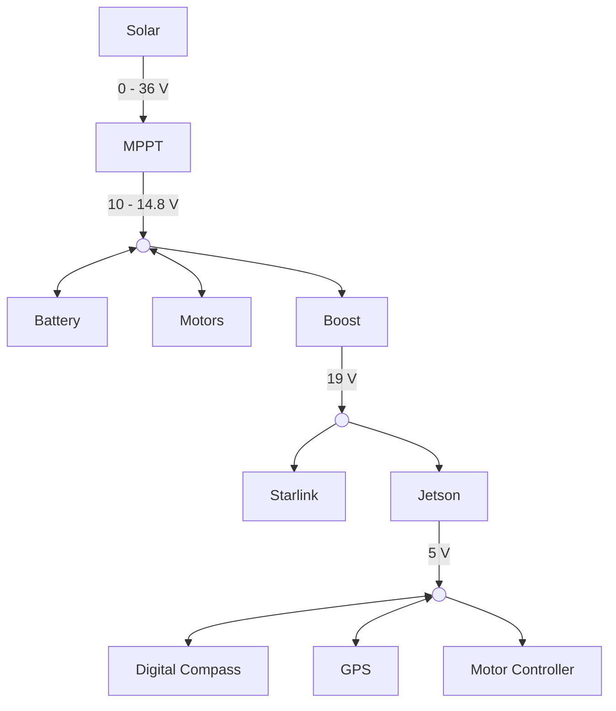

Several solar array ssupply power to the vehicle. Their output is conditioned via a maximum power point tracker (TBD) which regulates the output current to a safe range for the battery used on the vehicle. A single 12 V (10 - 14.8 V nominal) 100 Ah lithium iron phosphate (LFP) (TBD, likely to be increased) stores power generated by the solar arrays. The battery directly feeds the motors via a power bus. The rest of the navionics are powered from a 19 V rail generated by a boost converter from the battery voltage. See the diagram below for more details:

